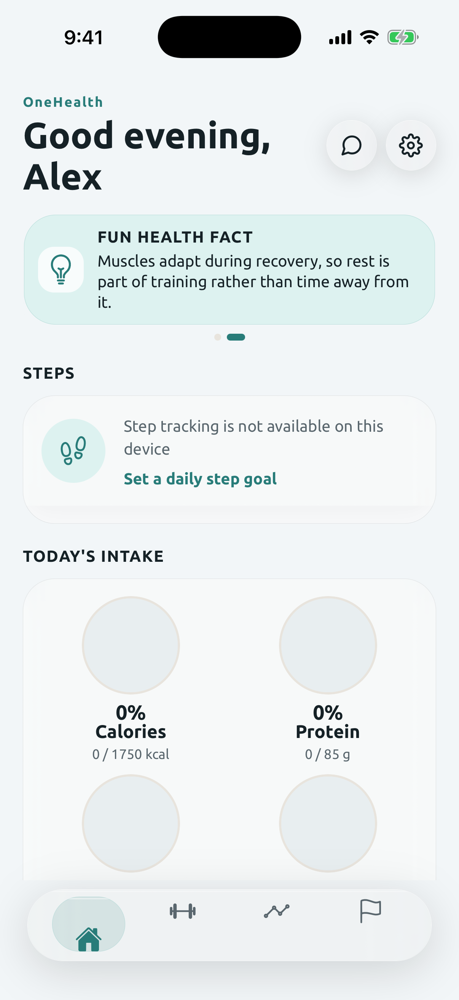
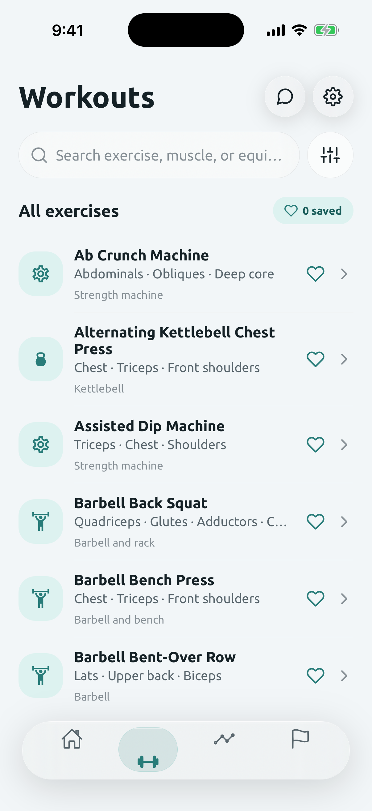
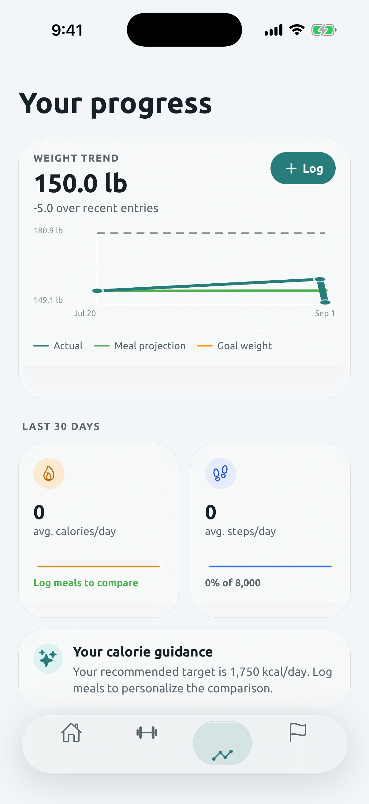
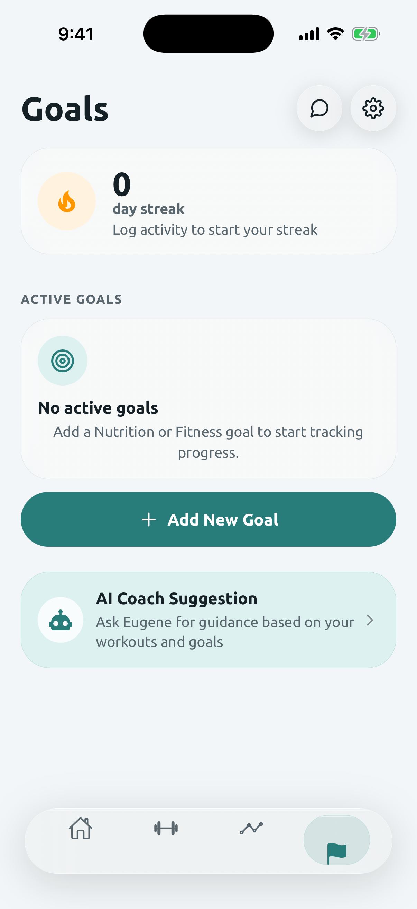
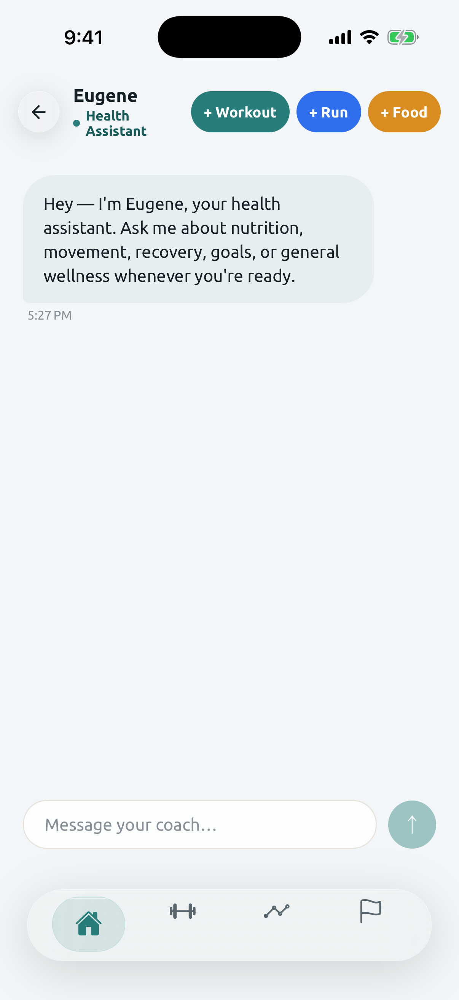
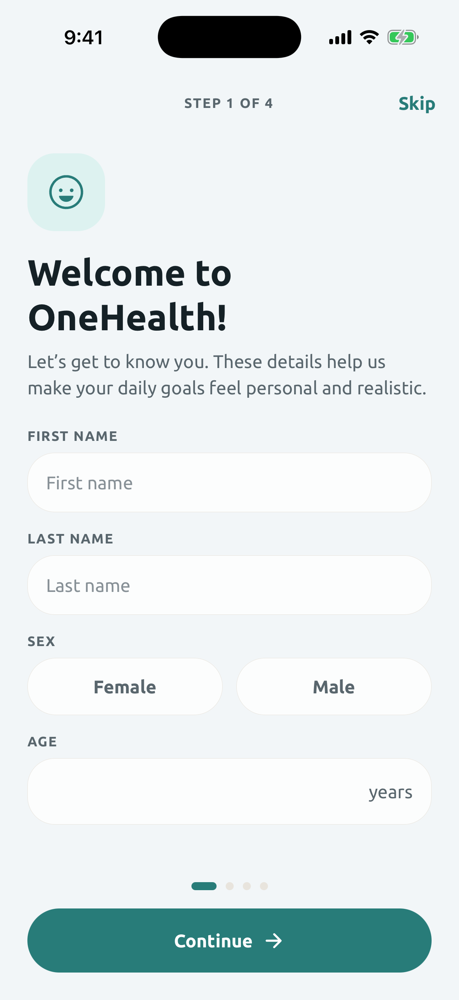
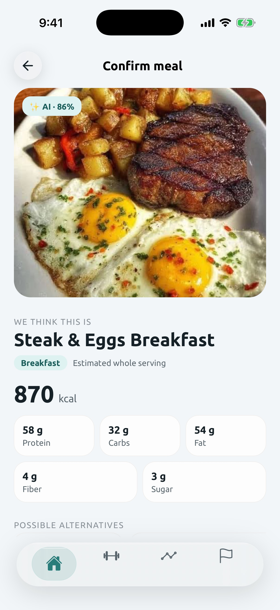

# OneHealth

A React Native (Expo) app for tracking meals, workouts, and daily health metrics, with an AI coach ("Eugene") for food logging and chat-based guidance.

## Screenshots

| Home | Workouts | Progress |
| --- | --- | --- |
|  |  |  |

| Goals | Eugene (AI coach) | Onboarding |
| --- | --- | --- |
|  |  |  |

| Meal logging |
| --- |
|  |

Captured on an iPhone 17 Pro simulator (iOS), showing the app's native "Liquid Glass" translucent cards and adaptive light/dark teal accent.

## Features

- Meal logging with AI-assisted food analysis from photos or text descriptions
- Workout tracking and exercise browsing by muscle group
- Daily step tracking and progress overview
- Goal setting and recommendations
- Chat-based AI coach for nutrition and fitness questions

## Tech stack

- [Expo](https://expo.dev) / React Native
- React Navigation
- A small Node.js API server (`server/`) that proxies requests to OpenAI for meal and chat analysis

## Getting started

```bash
npm install
npm start
```

This runs the local API server and the Expo dev server together. The server reads an `OPENAI_API_KEY` environment variable for AI-powered features.

Other scripts:

```bash
npm run ios      # start with iOS target
npm run android  # start with Android target
npm run web      # start with web target
```

## Project structure

- `App.js` — app entry point and navigation setup
- `src/screens` — top-level app screens
- `src/components` — shared UI components
- `src/eugene` — AI coach chat experience
- `src/foodlog` — meal photo capture and logging flow
- `src/utils` — nutrition, recommendation, and profile helpers
- `server/` — local API server proxying OpenAI requests
